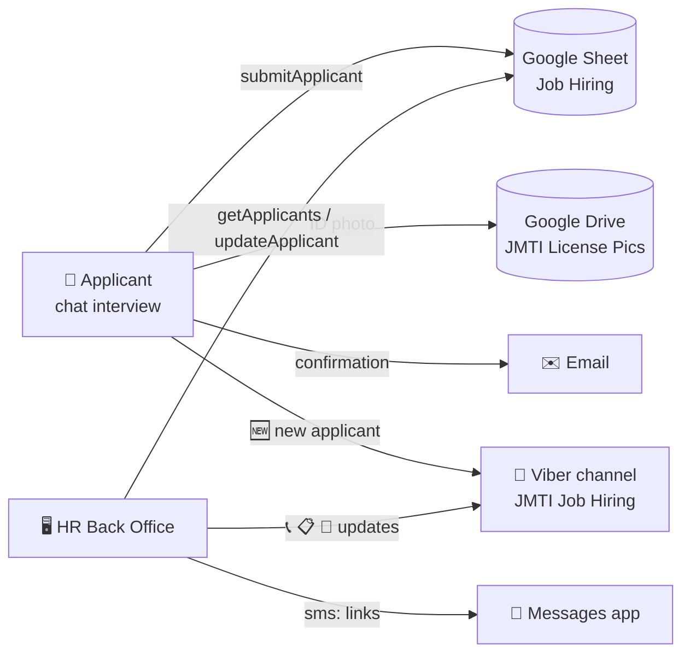

# 🚛 JMTI Hiring Desk

Online hiring system for **J. Magtalas Trucking Inc.** — built with Google Apps Script + Google Sheets, no servers.

| Part | What it does | Who uses it |
|---|---|---|
| 📝 **Applicant form** (`applicant-form/`) | Chat-style "interview": an HR persona asks one question at a time, applicants answer in a chat bubble UI. Saves to the Job Hiring sheet, uploads the ID photo to Drive, emails a confirmation, posts an alert to the Viber channel. | Applicants (public link) |
| 🖥️ **Back Office** (`back-office/`) | PIN-protected HR dashboard: KPI tiles, search & filters, applicant table (PC) / cards (phone), ID-photo preview, one-tap **Call / SMS templates** (Confirmation · Follow-up · Directions), mark *Called*, change *Status*, edit *Remarks*, CSV export. Changes post to the Viber channel. | HR (phone + PC) |
| 🌐 **GitHub Pages launcher** (`docs/`) | A branded page that embeds the applicant form, so you can share a friendly link instead of the long `script.google.com` one. | Applicants |



## 📸 Screenshots

| Applicant form (PC) | Applicant form (phone) | Thank-you |
|---|---|---|
|  |  |  |

| Back Office (PC) | Applicant panel | Phone — SMS templates |
|---|---|---|
|  |  |  |

Try them without deploying: open `previews/applicant-form-preview.html` and `previews/back-office-preview.html` (PIN `2468`) in a browser — sample data, nothing saved.

## 📂 Repo layout

```
applicant-form/   Code.js · Images.js · Index.html · appsscript.json   ← Apps Script project #1
back-office/      Code.js · Images.js · Index.html · appsscript.json   ← Apps Script project #2
docs/             index.html (GitHub Pages launcher) · jmti-logo.jpg · screenshots/
previews/         click-through demos (no backend)
assets/           logo + truck photo (originals)
```

Each project folder = one Apps Script project. In the Apps Script editor the files are named **Code**, **Images** and **Index** (the editor adds `.gs` / `.html`; `.js` here is just for Git/clasp).

## 🔧 Config — fill these in before deploying

Secrets are **not** in this repo. After copying the code into Apps Script, set:

| Where | Line | Value |
|---|---|---|
| both `Code.js` | `SPREADSHEET_ID` | the ID from your Job Hiring sheet URL `/spreadsheets/d/<ID>/edit` |
| both `Code.js` | `VIBER_AUTH_TOKEN` | Viber channel → channel info → **Developer tools → Post API** token |
| `back-office/Code.js` | `ACCESS_PIN` | the HR PIN (`''` = no PIN screen) |
| `back-office/Code.js` | `OFFICE` block | address, landmark, Google Maps link, office hours — used by the Directions SMS |
| `applicant-form/Code.js` | `BACKOFFICE_URL` | (optional) Back Office link, added to each Viber alert |

> ⚠️ Never commit a real Viber token or sheet ID to a public repo. Keep them only inside Apps Script.

## 🚀 Deploy

### A. Applicant form
1. [script.google.com](https://script.google.com) → **New project** → paste `Code.js` into **Code.gs**; add file **Images** (script) and **Index** (HTML) and paste the matching contents.
2. Fill in the config above.
3. Run **`viberSetup`** once (authorizes the script, finds the channel superadmin, registers the webhook Viber requires, posts a test message).
4. **Deploy → New deployment → Web app** → Execute as **Me** · Who has access **Anyone** (applicants must not be asked to sign in).
5. Copy the `/exec` link → paste it into `docs/index.html` (`APP_URL`).

### B. Back Office
Same steps in a second project, then **Deploy → Web app** → Execute as **Me** · access **Anyone** (the PIN protects it) — or *Anyone with Google account* for an extra layer. HR can "Add to Home Screen" on their phones.

### C. GitHub Pages (friendly public link)
Repo **Settings → Pages → Branch `main`, folder `/docs`** → your page is live at `https://<user>.github.io/<repo>/` and embeds the applicant form. Re-deploying the Apps Script keeps the same `/exec` link, so the page never needs changing.

### D. Using clasp (optional, for pushing from Git)
```bash
npm i -g @google/clasp && clasp login
cd applicant-form && cp .clasp.json.example .clasp.json   # put your scriptId in it
clasp push      # uploads Code.js, Images.js, Index.html, appsscript.json
```

## 🗂️ Sheet columns (tab `Job Hiring`, gid 0)
`# | Position | Applicant Name | Age | Contact # | Called \ nag usap | Address | License No. | License Pic. | Truck Driven | # Years of Experience | Status | Remarks | Email`

Statuses used by the Back Office: `Pending · For Interview · Hired · Not Qualified · Rejected` (edit `STATUSES` in `back-office/Code.js`). Age rules (Helper > 45, Driver ≥ 60 → *Not Qualified*) live in `applicant-form/Code.js`.

## 💬 Viber alerts
* Applicant form → `🆕 BAGONG APPLICANT #128 …` on every submission.
* Back Office → `📞 tinawagan na` · `📋 Status: Pending ➜ For Interview` · `📝 Remarks: …` (toggle each in `VIBER_EVENTS`).
* Viber refuses to post until a webhook is registered (`10 webhookNotSet`); `viberSetup` handles it and the app self-heals if it ever happens again.

## 📲 SMS templates
Three ready texts in `back-office/Code.js` → `SMS_TEMPLATES`, with placeholders `{first} {name} {no} {position} {company} {hrPhone} {address} {landmark} {maps} {hours} {bring}`. On a phone the button opens the Messages app with the text filled in; on PC use **Copy text** or **WhatsApp Web**. Sending can auto-log to Remarks.

---
Built with Google Apps Script · Vanilla HTML/CSS/JS · no frameworks, no servers.
